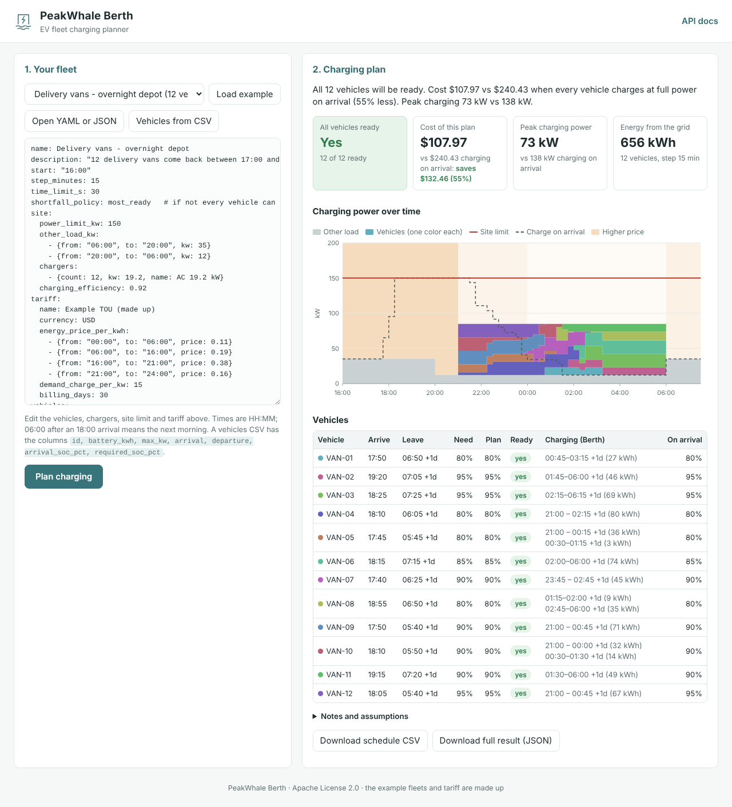

<p></p>

# PeakWhale™ Berth
### Plan depot charging so vehicles leave ready, at the lowest cost it can find.


[](https://github.com/PeakWhale/berth/actions/workflows/ci.yml)

**PeakWhale™ Berth** is a free, open-source planner for charging an electric fleet at a depot. You tell it when each vehicle arrives and leaves, how full the battery is and how full it must be, what chargers you have, how much power the site can take, and what electricity costs. Berth gives back a charging schedule for every vehicle, in 15-minute steps. When every vehicle can be ready, the schedule gets them all ready at the lowest cost it can find (proven within 1 % of the lowest possible, unless the time limit stops it first). When not, it says which vehicles fall short, by how much, and why. It also shows what would happen if every vehicle just charged at full power on arrival.

* **Command line:** `berth plan fleet.yaml` prints a summary and writes the schedule as CSV.
* **Web page and HTTP API:** upload or edit a fleet, see the power chart, download the plan. OpenAPI docs at `/docs`.
* **MCP server** (`berth-mcp`): lets Claude Desktop, Cursor or any MCP client plan and explain charging.

**Who it is for:** fleet and depot managers, energy and EV consultants, utility and charge-point teams who want a quick, honest plan, and developers who want a charging planner they can call from their own tools or AI assistant.

**The problem in 3 lines:**
1. Vehicles come back at different times and must leave with enough charge.
2. The site has a power limit, a fixed number of chargers, and other building load.
3. Electricity prices change during the day and the monthly peak is billed, so *when* you charge matters as much as *how much*.

> [!NOTE]
> All example fleets and the example tariff are made up (fixed random seed in `scripts/make_examples.py`). They are not real utility tariffs or real customer data.

## Quick start

You need Python 3.11+ and [uv](https://docs.astral.sh/uv/).

```bash
uv sync                                            # 1. install
uv run berth plan examples/delivery-vans.yaml      # 2. plan the example fleet (writes delivery-vans-schedule.csv)
uv run berth serve                                 # 3. open http://127.0.0.1:8000
```

Other commands: `uv run berth examples` (list the example fleets), `uv run berth explain examples/late-shift-infeasible.yaml` (the plan in plain words), `uv run berth plan examples/late-shift-infeasible.yaml --shortfall-policy fair` (share the shortfall instead of getting the most vehicles ready), `uv run berth plan --help`.

Useful `plan` options: `-o FILE` (name of the schedule CSV), `--no-csv`, `--json result.json` (also write the full result as JSON) and `--fail-if-short` (exit with code 4 if a vehicle falls short, handy in scripts). Exit codes: 0 done, 1 input error, 2 bad command-line options, 3 solver error, 4 a vehicle falls short (only with `--fail-if-short`), 5 an output file cannot be written.

Part of the output for the example vans (made-up data):

```text
All 12 vehicles will be ready. Cost $107.97 vs $240.43 when every vehicle charges at full power on arrival (55% less). Peak charging 73 kW vs 138 kW.

                   Berth plan  Charge on arrival
-----------------  ----------  -----------------
Total cost            $107.97            $240.43
  energy               $83.04            $182.93
  demand charge        $24.92             $57.50
Grid energy         655.6 kWh          655.6 kWh
Peak charging         72.8 kW           138.0 kW
Peak site load        84.8 kW           150.0 kW
Vehicles ready        12 / 12            12 / 12
```

The schedule CSV has one row per time step: time, price, site limit, other load, the kW for each vehicle, and the charge-on-arrival total for comparison.

## Input format

A fleet is one YAML (or JSON) file. This is a small but complete one:

```yaml
name: My depot
start: "16:00"            # plan start (default: the earliest arrival)
step_minutes: 15          # 5, 10, 15, 20, 30 or 60
shortfall_policy: most_ready   # only used when not every vehicle can be ready (see below)
site:
  power_limit_kw: 150     # most power the whole site may take
  other_load_kw:          # building load; charging can use the limit minus this
    - {from: "06:00", to: "20:00", kw: 35}
    - {from: "20:00", to: "06:00", kw: 12}
  chargers:
    - {count: 10, kw: 19.2}
    - {count: 2, kw: 50}
  charging_efficiency: 0.92   # share of grid energy that ends up in the battery
tariff:
  currency: USD
  energy_price_per_kwh:
    - {from: "00:00", to: "06:00", price: 0.11}
    - {from: "06:00", to: "16:00", price: 0.19}
    - {from: "16:00", to: "21:00", price: 0.38}
    - {from: "21:00", to: "24:00", price: 0.16}
  demand_charge_per_kw: 15    # per kW of the monthly peak (optional)
vehicles:
  - {id: VAN-01, battery_kwh: 70, max_kw: 11, arrival: "17:50", departure: "06:50", arrival_soc_pct: 45, required_soc_pct: 80}
  - {id: VAN-02, battery_kwh: 113, max_kw: 19.2, arrival: "18:25", departure: "07:25", arrival_soc_pct: 39, required_soc_pct: 95}
```

| Field | Meaning |
| --- | --- |
| `battery_kwh` | usable battery size |
| `max_kw` | fastest charging power the vehicle accepts |
| `arrival_soc_pct` | battery level when it arrives, in percent |
| `required_soc_pct` | battery level it needs when it leaves |
| `arrival`, `departure` | `HH:MM`, or a full date and time like `2026-03-02T06:30`. A UTC offset (`2026-03-02T06:30+01:00`) is allowed; times with different offsets are converted to one clock. |
| `stops` | instead of one arrival and departure: a list of stops, each with `arrival`, `departure`, `required_soc_pct` and `trip_kwh` (energy used on the road since the last stop). See `examples/school-buses.yaml`. |
| `power_limit_kw`, `other_load_kw`, `energy_price_per_kwh` | one number, a list of 24 hourly values, or periods `{from, to, value}` (`price` or `kw` also work as the value name) |
| `billing_days` | a one-day plan carries 1/30 of the monthly demand charge by default. Set it to 1 to count the full charge. |
| `hours`, `time_limit_s` | plan length (default: until the last departure) and time limit for the whole plan, explaining any shortfalls included (default 30 s) |
| `shortfall_policy` | what to do when not every vehicle can be ready: `most_ready` (default) or `fair`. See "When not every vehicle can be ready" below. |
| `vehicles` | the list of vehicles, or the name of a vehicle CSV file next to the fleet file (`vehicles: vans.csv`, command line only) |

**Times:** quotes around times are optional (`arrival: 17:30` works). A departure earlier than the arrival means the next day. Berth rounds each arrival up and each departure down to the time step, so a vehicle only charges in steps where it is parked the whole time.

**Tariff or vehicles in their own file:** `tariff: tariff-tou.yaml` reads the tariff from a file next to the fleet file (command line only). See `examples/tariff-tou.yaml`. `vehicles: vans.csv` works the same way for the vehicles, in the CSV format below.

**CSV instead of YAML:** one row per vehicle (or per stop), plus the site settings as options:

```bash
uv run berth plan --vehicles examples/csv/vans.csv --tariff examples/csv/tariff-tou.csv \
  --chargers 12x19.2 --site-limit-kw 150 --other-load-kw 12 --start 16:00 \
  --efficiency 0.92 --demand-charge 15
```

These are the vans, tariff and chargers of `examples/delivery-vans.yaml`, but the results differ a little ($119.47 instead of $107.97): on the command line the other load is one flat value (12 kW here; the YAML has 35 kW by day), so more of the peak counts for the demand charge. Without `--efficiency` and `--demand-charge` the efficiency is 1 and there is no demand charge. To keep everything else in YAML, use `vehicles: vans.csv` in the fleet file instead.

Vehicle CSV columns: `id, battery_kwh, max_kw, arrival, departure, arrival_soc_pct, required_soc_pct` (and `trip_kwh` for later stops; use the same `id` on several rows for several stops). Tariff CSV: `hour,price_per_kwh` (24 rows) or `from,to,price`.

**Clear errors.** Mistakes get a message that says what to fix and where, for example:

```text
Input error: bad.yaml: found 2 problems:
  - vehicle 2 (B): max_kw: is required but missing
  - vehicle 2 (B): arival: is not a known field (check the spelling)
Input error: my-vans.csv: line 3: battery_kwh 'eighty' is not a number
```

## How it works

1. Berth cuts the plan into time steps (15 minutes by default). For each vehicle and step it decides the charging power in kW.
2. **Limits, always kept:**
   * a vehicle charges only while it is parked;
   * power is never above the vehicle's `max_kw` or the charger's kW;
   * all charging together stays under the site limit minus the other load, in every step;
   * the battery never goes above 100 %;
   * in each step, no more vehicles charge than there are chargers (per charger power group).
3. **Goals, in this order:**
   1. *Readiness.* Every vehicle reaches its required level at departure. If that is impossible, the `shortfall_policy` decides (see point 6).
   2. *Cost.* Energy cost (price × grid energy in each step) plus the demand charge (rate × peak kW).
   3. *Tidy.* At the same lowest cost: a lower peak, and vehicles that leave first charge first, so each vehicle gets one block of charging where possible.
4. **Solver.** It is a linear program, solved with the open-source [HiGHS](https://highs.dev) solver. When a step has more parked vehicles than chargers, Berth adds on/off variables for that step only, which makes it a mixed-integer program. For large cases it first solves an easier version and fixes the chargers a few hours at a time, then checks the answer against a proven lower bound. It stops when the cost is proven to be within 1 % of the lowest possible cost, or at the time limit; the result says which. If the time runs out before it finds anything better, the plan is the best one found so far, at worst charging on arrival.
5. **Baseline.** "Charge on arrival" means every vehicle charges at full power from the moment it arrives until it is ready, first come first served for chargers and site power. The solver starts from this plan. So the Berth plan is never less ready than the baseline (with `most_ready`: never fewer vehicles fully ready; with `fair`: never a bigger shortfall that could be avoided), and, when the baseline gets everyone ready, never more expensive.
6. **When not every vehicle can be ready,** Berth still returns the best partial plan. You choose how with `shortfall_policy`:
   * `most_ready` (default): a fleet manager first wants to know how many vehicles can run their routes. Berth gets as many vehicles **fully ready** as possible. Then, keeping that number, it makes the biggest avoidable shortfall of the other vehicles as small as possible, then their total shortfall, and only then looks at cost. It uses one on/off variable per vehicle to count the ready vehicles.
   * `fair`: Berth makes the **biggest** avoidable shortfall over all vehicles as small as possible, then the total. Every vehicle gets some charge, but fewer vehicles may be fully ready.

   "Avoidable" leaves out the part a vehicle could never get, even charging alone, because it is not parked long enough. That part does not count against the other vehicles. So the biggest shortfall in the results can be bigger than the one Berth worked on.

   Set it in the fleet file (`shortfall_policy: fair`), on the command line (`--shortfall-policy fair`), in the API (`?shortfall_policy=fair`) or in the MCP tools (`shortfall_policy`). For each vehicle that falls short, Berth says how many kWh are missing and why:
   * `not_enough_time`: even alone at full power the whole time it is parked, it cannot get there;
   * `site_limit`: with unlimited site power the shortfall would be smaller;
   * `too_few_chargers`: with unlimited chargers the shortfall would be smaller.

   It also says what would help, for example "about 8 kW more site capacity", or how many more chargers. Berth finds these numbers by solving the problem again with extra site power or extra chargers.

**Simplification (chargers):** Berth counts how many vehicles charge in each step on each charger power group, but it does not say which exact charger a vehicle uses. If vehicles share chargers, someone has to move the plugs between time steps. With one charger per vehicle this does not matter.

**Demand charge:** it is billed per month, but a plan is about one day. By default a plan counts 1/30 of the monthly charge (as if every day had the same peak), and only the part of the peak caused by charging (the other load is there anyway).

## Results on the example fleets

Made-up example data. "On arrival" is the baseline: every vehicle charges at full power from arrival. Costs are for one plan window (about one day), with 1/30 of the monthly demand charge. The infeasible example is shown with both shortfall policies. Produced by this command (solve time depends on the computer):

```bash
uv run python scripts/example_results.py
```

| Example | Vehicles | Chargers | Ready (Berth / on arrival) | Cost (Berth / on arrival) | Saving | Peak charging kW (Berth / on arrival) | Biggest shortfall kWh (Berth / on arrival) | Solve time |
|---|---|---|---|---|---|---|---|---|
| delivery-vans | 12 | 12 x 19.2 kW | 12 / 12 | $107.97 / $240.43 | $132.46 (55.1%) | 73 / 138 | 0.0 / 0.0 | 0.0 s |
| late-shift-infeasible | 11 | 4 x 22 kW | 9 / 8 | $94.28 / $90.62 | -$3.66 (-4.0%) | 55 / 55 | 57.0 / 67.5 | 2.3 s |
| late-shift-infeasible (shortfall_policy: fair) | 11 | 4 x 22 kW | 5 / 8 | $94.28 / $90.62 | -$3.66 (-4.0%) | 55 / 55 | 43.8 / 67.5 | 0.7 s |
| school-buses | 30 | 4 x 60 kW + 20 x 19.2 kW | 30 / 30 | $824.86 / $1,262.64 | $437.78 (34.7%) | 380 / 380 | 0.0 / 0.0 | 5.4 s |

* **Delivery vans:** charging moves out of the 16:00–21:00 price peak into the night, and the peak charging power is about half, so the demand charge is lower too.
* **School buses:** 24 chargers for 30 buses, with a midday break and the night. Both plans reach the site limit at some point, so here the saving comes from the energy price: charging moves out of the evening peak.
* **Late shift (cannot be fully charged):** 11 vans, 4 chargers and a small site connection. With the default `most_ready` policy, Berth gets 9 vans fully ready, one more than charging on arrival (8). Only EARLY-5 (19.9 kWh short) and SHORT-STOP (57.0 kWh short) fall short, and even the biggest shortfall is smaller than with charging on arrival (67.5 kWh). With `shortfall_policy: fair`, Berth shares the avoidable shortfall instead: the biggest shortfall drops to 43.8 kWh (SHORT-STOP, which could never get 37.1 kWh of it), but only 5 vans are fully ready (every EARLY van is 6.6 kWh short). In both cases Berth delivers more energy than charging on arrival (500.0 vs 480.7 kWh), which is why its cost is a little higher. It also reports that SHORT-STOP is not parked long enough to be ready, and that about 8 kW more site capacity would be enough for every other van.

## Web page

`uv run berth serve`, then open http://127.0.0.1:8000.



* Pick an example, open a YAML or JSON fleet file, or load vehicles from a CSV. You can also edit the fleet in the text box.
* The page cannot read a second file, so a fleet file that names its tariff file (`tariff: tariff-tou.yaml`, like the files in `examples/`) must have the tariff written out instead. For the bundled examples, use **Load example**.
* **Plan** shows cards (vehicles ready, cost vs on arrival, peak, energy), a stacked power chart per vehicle with the site limit line, the on-arrival line and price shading, a table of vehicles and charging windows, and any shortfalls with reasons.
* Download the schedule as CSV or the full result as JSON.

It is plain HTML, CSS and JavaScript served by the API. There is no build step.

## HTTP API

Interactive docs: http://127.0.0.1:8000/docs (OpenAPI).

```bash
# get an example fleet as JSON, then plan it
curl -s http://127.0.0.1:8000/api/examples/delivery-vans > fleet.json
curl -s -X POST http://127.0.0.1:8000/api/plan -H "Content-Type: application/json" -d @fleet.json

# send YAML text instead (the tariff must be inside the text, not a file name)
curl -s "http://127.0.0.1:8000/api/examples/late-shift-infeasible?format=yaml" > fleet.yaml
curl -s -X POST http://127.0.0.1:8000/api/plan/yaml -H "Content-Type: text/plain" --data-binary @fleet.yaml

# the schedule as CSV, or the plan in plain words
curl -s -X POST http://127.0.0.1:8000/api/schedule.csv -H "Content-Type: application/json" -d @fleet.json
curl -s -X POST http://127.0.0.1:8000/api/explain -H "Content-Type: application/json" -d @fleet.json
```

| Endpoint | What it does |
| --- | --- |
| `POST /api/plan` | plan a fleet (JSON). Returns the schedule, costs, savings, shortfalls and notes. Optional `?shortfall_policy=most_ready` or `fair` (overrides the fleet's setting; also on the other plan endpoints). |
| `POST /api/plan/yaml` | the same, with the fleet as YAML text |
| `POST /api/schedule.csv` | the schedule as CSV |
| `POST /api/explain` | the plan explained in plain words |
| `GET /api/examples`, `GET /api/examples/{name}` | the example fleets |
| `POST /api/convert/...` | YAML to JSON, JSON to YAML, vehicle CSV to JSON (used by the web page) |

Bad input gets status 422 (or 400) with a `problems` list that says what to fix. The API never opens a file name that comes in a request, and the time limit is capped at 60 s (`BERTH_MAX_TIME_LIMIT`). The limit covers the whole request, so a plan comes back in about that time.

## MCP server

Two tools for AI assistants:

| Tool | What it does |
| --- | --- |
| `plan_charging` | plan a fleet and return the key numbers as JSON: cost, peak and readiness for the plan and for charging on arrival, charging windows per vehicle, shortfalls with reasons. `include_schedule: true` adds kW per vehicle per step. |
| `explain_plan` | plan a fleet and explain the result in plain words |

Give the fleet as `fleet` (an object), `fleet_yaml` (text), or `example` (`delivery-vans`, `school-buses`, `late-shift-infeasible`). Both tools also take `shortfall_policy` (`most_ready` or `fair`).

Add this to your client's config (`claude_desktop_config.json` for Claude Desktop, `.cursor/mcp.json` for Cursor):

```json
{
  "mcpServers": {
    "berth": {
      "command": "uv",
      "args": ["--directory", "/absolute/path/to/berth", "run", "berth-mcp"]
    }
  }
}
```

If the client cannot find `uv`, use its full path (see `which uv`). Then ask, for example: *"Plan charging for the school-buses example and tell me how much we save compared with charging on arrival."*

## Docker

```bash
docker build -t berth .
docker run --rm -p 8000:8000 berth                           # web page and API on http://localhost:8000
docker run --rm berth berth plan --example delivery-vans     # command line

# plan your own fleet file: mount the folder it is in; the schedule CSV is written next to it
docker run --rm -v "$PWD:/data" --user "$(id -u):$(id -g)" berth berth plan fleet.yaml
```

## Limits

* **One site, one plan at a time.** Berth plans a fixed window (up to 7 days). It does not re-plan when a vehicle is late; run it again with new times.
* **Chargers are counted, not assigned** (see "Simplification" above).
* **Charging power is flat.** Real batteries charge slower when nearly full. Berth uses one `max_kw` per vehicle; set it a bit lower if your vehicles slow down a lot.
* **Simple tariffs.** One price per time step, one demand charge per kW. No weekday/weekend tariffs, tiers or export prices yet.
* **No vehicle priorities.** `most_ready` counts every vehicle the same. It does not know that one route matters more than another.
* **Large, crowded sites can be slow.** Many vehicles sharing few chargers is a hard puzzle, and it is hardest when not everyone can be ready: with `most_ready`, each solver stage after counting the ready vehicles gets part of the time limit, and about a fifth of it is kept for explaining the shortfalls. Berth stops at the time limit and the result says so.
* **No login.** The server listens on `127.0.0.1` by default. Add your own security before you share it.

## Next ideas

* **V2G:** let parked vehicles send power back to the site at peak times.
* **Live telematics:** read battery levels and arrival times from the vehicles and re-plan during the night.
* **Solar and storage** at the depot, and export prices.
* **Vehicle priorities:** say which routes must run first when not every vehicle can be ready.
* Exact charger assignment (which vehicle on which charger) and plug-in time rules.
* Weekday and seasonal tariffs, and plans over a full billing month.

## Project layout

```text
berth/
├── src/berth/
│   ├── models.py        # input format (Pydantic) and checks
│   ├── problem.py       # fleet -> time steps
│   ├── optimizer.py     # the LP / MIP model and solve stages (HiGHS)
│   ├── baseline.py      # charge on arrival
│   ├── diagnose.py      # why vehicles fall short, what would help
│   ├── planner.py       # plan(): everything together
│   ├── cli.py, api.py, mcp_server.py
│   └── web/             # the web page (HTML, CSS, JavaScript)
├── examples/            # made-up fleets and tariff (YAML and CSV)
├── scripts/             # make_examples.py, example_results.py
└── tests/               # pytest
```

Use it from Python too:

```python
from berth.examples import load_example
from berth.planner import plan

result = plan(load_example("delivery-vans"))
print(result.headline)
```

## Tests

```bash
uv run pytest
```

The tests check that every vehicle reaches its required level, that no limit is ever broken (site, chargers, vehicle and charger power, full battery), that the plan never costs more than charging on arrival when that gets everyone ready, that with the default policy the plan never has fewer vehicles fully ready than charging on arrival (and with `fair` never a bigger avoidable shortfall), that shortfalls and their reasons are reported, the API, command line and MCP round trips, and clear errors for bad YAML and CSV. CI runs them on Python 3.11, 3.12 and 3.13, and builds the Docker image.

## Background

The ideas behind Berth are in this whitepaper: [Planning EV charging around fleet operations: connecting vehicle readiness, site capacity, and energy cost to a feasible charging schedule](https://adrkv.github.io/ev-charging-operations.html).

## Part of the PeakWhale™ fleet

* **PeakWhale™ Helm**: research assistant over your own data.
* **PeakWhale™ Orca**: fraud check for card purchases, with plain-English reasons.
* **PeakWhale™ Harbor**: turn a spreadsheet into a prediction API.
* **PeakWhale™ Trident**: fail-safe triage engine, AI plus editable rules; unclear cases go to a person.
* **PeakWhale™ Berth**: EV fleet charging planner.

## License
Apache License 2.0 © 2026 Aditya Rao (Addy) Kaveti. See [LICENSE](LICENSE) and [NOTICE](NOTICE). If you share or build on Berth, keep the NOTICE file. PeakWhale™ is Addy's project name; the license does not cover the name or logo.

## Author
Built by Addy
